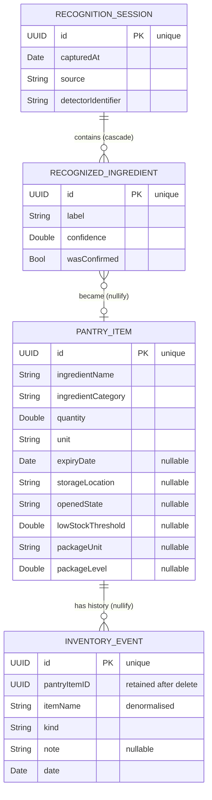

# SwiftData Model and Relationships

**Status:** **[Proposal]**, grounded in **[Verified]** readings of the existing
domain models.

---

## 1. Design constraints

Three rules this schema is held to:

1. **No artificial entities.** Every table must correspond to something the app
   already produces or genuinely needs. The brief forbids inflating the table
   count, and a marker can tell.
2. **No redundant storage.** **[Verified]** the existing `PantryItem` is
   careful about this — `inventoryQuantity` is *derived*, not stored, "so there
   is exactly one amount in the model and it cannot drift from what recipes
   read" (`Domain/Models/PantryItem.swift:86-96`). The schema must not undo
   that.
3. **Storage types are not domain types.** `@Model` classes live only in
   `Data/SwiftData/`. The domain keeps its plain structs.

---

## 2. Entities

### 2.1 `PantryItemEntity` — maps `PantryItem` **[Verified]** 1:1

Derived from `Domain/Models/PantryItem.swift:25-77`. Stores the eleven stored
properties and **not** the four computed ones (`inventoryQuantity`, `storage`,
`opened`, `isLowStock`, `expiryState`), which stay derived in the domain struct.

| Attribute | Type | Notes |
|---|---|---|
| `id` | `UUID` | `@Attribute(.unique)` — stable identity, same UUID as Firestore's document id |
| `ingredientName` | `String` | flattened from `Ingredient.name` — see §2.5 |
| `ingredientCategory` | `String` | `IngredientCategory.rawValue` |
| `quantity` | `Double` | canonical amount |
| `unit` | `String` | `MeasurementUnit.rawValue` |
| `expiryDate` | `Date?` | `nil` = not tracked, **never** defaulted to a date |
| `storageLocation` | `String?` | `nil` = never recorded |
| `openedState` | `String?` | |
| `lowStockThreshold` | `Double?` | |
| `packageUnit` | `String?` | |
| `packageLevel` | `Double?` | |
| `events` | `[InventoryEventEntity]` | inverse of §2.2 |

**Enums are stored as `rawValue` strings, not as the enum type.** SwiftData can
persist `RawRepresentable` enums, but raw strings keep the stored shape
**identical to the Firestore documents** (**[Verified]**,
`FirestorePantryRepository.swift:75-81` writes `category.rawValue`,
`unit.rawValue`). That means one import path, one decode story, and a
forward-compatible read: an unrecognised value decodes to `nil` rather than
discarding the row — the rule the Firestore decoder already follows and
documents (`FirestorePantryRepository.swift:151-158`).

### 2.2 `InventoryEventEntity` — maps `InventoryEvent` **[Verified]** 1:1

From `Domain/Models/Inventory/InventoryEvent.swift:69-96`.

| Attribute | Type | Notes |
|---|---|---|
| `id` | `UUID` | `@Attribute(.unique)` |
| `pantryItemID` | `UUID` | the id, kept **even when the relationship is nil** — see §3.1 |
| `itemName` | `String` | **deliberately denormalised** — see §3.1 |
| `kind` | `String` | `InventoryEventKind.rawValue` |
| `note` | `String?` | absent ≠ empty string |
| `date` | `Date` | client clock, by existing design |
| `item` | `PantryItemEntity?` | optional — the item may be gone |

### 2.3 `RecognitionSessionEntity` — **new capability**

**[Verified]** the app's headline feature currently persists nothing: the YOLO +
Vision + fusion pipeline produces detections that flow to
`AddDetectedIngredientsUseCase` and are then discarded
(`PERSISTENCE_ARCHITECTURE_AUDIT.md` §5, item 10).

| Attribute | Type | Notes |
|---|---|---|
| `id` | `UUID` | `@Attribute(.unique)` |
| `capturedAt` | `Date` | |
| `source` | `String` | `localCamera` / `remoteCamera` / `receipt` |
| `detectorIdentifier` | `String` | e.g. `YOLO11n+AppleVision` — which model produced this |
| `detections` | `[RecognizedIngredientEntity]` | cascade; §3.2 |

This is not an invented table. It records a real event the app already performs,
and it is the only entity here that adds *new* user-visible value: a history of
what the fridge camera saw.

### 2.4 `RecognizedIngredientEntity` — one detection within a session

| Attribute | Type | Notes |
|---|---|---|
| `id` | `UUID` | `@Attribute(.unique)` |
| `label` | `String` | canonicalised name |
| `confidence` | `Double` | 0…1, as the fusion service reports it |
| `wasConfirmed` | `Bool` | did the user accept it in the review sheet? |
| `session` | `RecognitionSessionEntity?` | inverse of §2.3 |
| `createdItem` | `PantryItemEntity?` | the item this became, if confirmed; §3.3 |

`wasConfirmed` plus `createdItem` is what makes the model measurable: it records
not just what the detector claimed, but whether a human agreed.

> **If scope must be cut**, drop §2.3 and §2.4 together and ship with two
> entities and one relationship. The rubric's "multi-entity relational" bar is
> met by `PantryItemEntity` ↔ `InventoryEventEntity` alone. These two are the
> stretch that makes the schema interesting rather than minimal.

### 2.5 Why `Ingredient` is flattened, not its own table

**[Verified]** `Ingredient` (`Domain/Models/Ingredient.swift:11-20`) carries a
`UUID` that is **generated fresh on every construction** and is never persisted
by the Firestore adapter — only `name` and `category` are stored
(`FirestorePantryRepository.swift:76-77`), and `decode` builds a **new**
`Ingredient` with a **new** id on every read (`:173`).

So `Ingredient.id` has no stable identity today. Promoting `Ingredient` to a
table would mean inventing one, deduplicating by name, and deciding what happens
when two users spell "Greek Yogurt" differently — a real modelling problem with
no current payoff. **Flattening is the honest choice**, and it keeps the
SwiftData rows byte-comparable with the Firestore documents.

---

## 3. Relationships and delete rules



### 3.1 `PantryItem` → `InventoryEvent`: **nullify**, and the id is kept

```swift
@Relationship(deleteRule: .nullify, inverse: \InventoryEventEntity.item)
var events: [InventoryEventEntity] = []
```

**Cascade would be a bug, not a style choice.** **[Verified]** from the domain:

- `InventoryEvent.pantryItemID` is documented as "kept even after the item is
  removed, so an item's history survives finishing or discarding it"
  (`InventoryEvent.swift:63-65`).
- `RecordFoodOutcomeUseCase` **removes the pantry item** and then writes a
  `finished`/`discarded` event (`RecordFoodOutcomeUseCase.swift:80-88`).

Under a cascade rule, finishing a carton of milk would delete the item and
therefore delete the very event recording that it was finished. The activity
history would be permanently empty. **Nullify is required for correctness.**

This is also why both `pantryItemID` **and** the `item` relationship exist: the
relationship goes `nil` on delete, the raw UUID does not, and
`InventoryStore.history(for:)` (`ViewModels/InventoryStore.swift:150-152`)
filters on the UUID. Keeping the scalar is what makes history survive.

And it is why `itemName` is denormalised onto the event — **[Verified]** the
domain says so outright: "the item may be gone by the time this is read, and
'Finished' with no name is not history" (`InventoryEvent.swift:76-77`). This is
the one documented exception to the no-redundancy rule in §1.

### 3.2 `RecognitionSession` → `RecognizedIngredient`: **cascade**

```swift
@Relationship(deleteRule: .cascade, inverse: \RecognizedIngredientEntity.session)
var detections: [RecognizedIngredientEntity] = []
```

Opposite reasoning, and that contrast is the point: a detection has **no meaning
without the session that produced it**. "0.82 confidence on tomato" is not a
fact about the kitchen, it is a fact about one camera frame. Orphaned detections
would be unreadable rows that only grow.

### 3.3 `RecognizedIngredient` → `PantryItem`: **nullify**, optional

Optional on both sides: a detection the user rejected never becomes an item, and
an item added by hand has no detection. Nullify because deleting food must not
erase the record that the detector once saw it — that record is the model's
accuracy evidence (§5, Q2).

### 3.4 Uniqueness and validation

| Constraint | Where enforced | Why there |
|---|---|---|
| `id` unique on all four entities | `@Attribute(.unique)` | storage-level; makes re-import idempotent |
| Ingredient name unique per pantry | **use case, not schema** | `AddPantryItemUseCase:65` already rejects duplicates via `Ingredient.matches(name:)`, which normalises case and whitespace — a SQL unique index could not express that, and would reject "Milk" vs "milk" inconsistently with the Firebase path |
| `quantity >= 0` | use case (`AddPantryItemUseCase:62`) | already there |
| Non-blank name | use case (`AddPantryItemUseCase:59`) | already there |
| `confidence` in 0…1 | mapper | detector contract |

**The rule: identity constraints in the schema, business rules in use cases.**
Putting the duplicate-name rule in the database would duplicate logic that
**[Verified]** already exists and is tested, and would make the two backends
behave differently.

> **Note:** `@Attribute(.unique)` is incompatible with SwiftData's CloudKit
> integration. This is one reason CloudKit was rejected
> (`COREDATA_VS_SWIFTDATA_DECISION.md` §5).

---

## 4. Mapping

Pure static functions with no container dependency — the pattern **[Verified]**
to be already used and unit-tested for Firestore
(`FirestorePantryRepository.swift:73-183`):

```swift
enum PantryItemMapper {
    static func toDomain(_ entity: PantryItemEntity) -> PantryItem {
        PantryItem(
            id: entity.id,
            ingredient: Ingredient(
                name: entity.ingredientName,
                category: IngredientCategory(rawValue: entity.ingredientCategory) ?? .other
            ),
            quantity: entity.quantity,
            unit: MeasurementUnit(rawValue: entity.unit) ?? .pieces,
            expiryDate: entity.expiryDate,
            storageLocation: entity.storageLocation.flatMap(StorageLocation.init(rawValue:)),
            openedState: entity.openedState.flatMap(OpenedState.init(rawValue:)),
            lowStockThreshold: entity.lowStockThreshold,
            packageUnit: entity.packageUnit.flatMap(PackageUnit.init(rawValue:)),
            packageLevel: entity.packageLevel.flatMap(PackageLevel.init(rawValue:))
        )
    }

    static func apply(_ item: PantryItem, to entity: PantryItemEntity) { /* … */ }
}
```

`apply(_:to:)` rather than a second `toEntity` for updates: mutating the fetched
object is what keeps SwiftData's change tracking correct. An `update` that
inserted a fresh entity with the same `id` would trip the unique constraint.

---

## 5. Two meaningful relational queries

Both answer questions the app already asks of its user.

### Q1 — "What should I use first, and what has already happened to it?"

Backs the **[Verified]** existing "Use First" section of the Kitchen screen
(`IdentifyExpiringInventoryUseCase:28-33`), which today gets its data by
fetching everything and filtering in Swift.

```swift
let threeDaysOut = Calendar.current.date(byAdding: .day, value: 3, to: .now)!

var descriptor = FetchDescriptor<PantryItemEntity>(
    predicate: #Predicate { item in
        item.expiryDate != nil && item.expiryDate! <= threeDaysOut
    },
    sortBy: [
        SortDescriptor(\.expiryDate, order: .forward),
        SortDescriptor(\.ingredientName, order: .forward),
    ]
)
descriptor.relationshipKeyPathsForPrefetching = [\.events]
let urgent = try context.fetch(descriptor)
```

Exercises: a compound predicate over an optional date, a two-key sort matching
the **[Verified]** existing ordering rule ("soonest expiry first, then
alphabetical", `IdentifyExpiringInventoryUseCase:66-72`), and relationship
prefetching to avoid an N+1 read of each item's history.

### Q2 — "Which ingredients does the detector get wrong?"

Only possible because of the §2.3/§2.4 entities. Traverses a relationship
**in reverse** — from detections back to whether they became pantry items.

```swift
let descriptor = FetchDescriptor<RecognizedIngredientEntity>(
    predicate: #Predicate { detection in
        detection.confidence >= 0.6 && detection.wasConfirmed == false
    },
    sortBy: [SortDescriptor(\.confidence, order: .reverse)]
)
let overconfident = try context.fetch(descriptor)

// Which labels does the model assert loudly and get rejected on?
let byLabel = Dictionary(grouping: overconfident, by: \.label)
    .mapValues(\.count)
    .sorted { $0.value > $1.value }
```

This is genuinely useful: it names the labels the model is confidently wrong
about, from real user decisions. It also demonstrates a predicate over a boolean
and a `Double`, plus aggregation — and it is a strong thing to show a marker,
because it is analysis the cloud schema cannot currently produce at all.

---

## 6. What is deliberately *not* modelled

| Candidate | Decision | Reason |
|---|---|---|
| `SavedRecipe` | Excluded | `nonisolated` protocol would force `@ModelActor`; feature **[Verified]** gated off |
| `Recipe` / `RecipeIngredient` | Excluded | Bundled recipes are compiled-in constants, not user data. Persisting them would duplicate the app bundle into the database |
| `Ingredient` as a table | Excluded | No stable identity today (§2.5) |
| WebRTC sessions, devices | Excluded | Real-time infrastructure — **[Verified]** needs listeners |
| `User` | Excluded | Firebase Auth owns identity |

---

## 7. Schema versioning and migration

**[Proposal]** Use `VersionedSchema` from the first commit, before there is any
data to lose:

```swift
enum FridgeFitSchemaV1: VersionedSchema {
    static let versionIdentifier = Schema.Version(1, 0, 0)
    static var models: [any PersistentModel.Type] {
        [PantryItemEntity.self, InventoryEventEntity.self,
         RecognitionSessionEntity.self, RecognizedIngredientEntity.self]
    }
}

enum FridgeFitMigrationPlan: SchemaMigrationPlan {
    static var schemas: [any VersionedSchema.Type] { [FridgeFitSchemaV1.self] }
    static var stages: [MigrationStage] { [] }
}
```

The cost today is ~15 lines and zero behaviour. The cost of adding it *after* a
grader has data in the store is a lost store or a hand-written migration. Adding
a property later is then a lightweight migration; renaming or changing a type is
a custom stage.

**No data migration is required for v1**: the store starts empty, and
`DATA_MODEL_AND_RELATIONSHIPS` does not import from Firestore
(`FIREBASE_COMPATIBILITY_AND_ROLLBACK.md` §4 covers the optional one-way import).

---

## 8. Unresolved questions

1. **Does the recognition pipeline expose a stable detector identifier?**
   `IngredientDetectorFactory` was not read in full during this audit. If no
   identifier exists, `detectorIdentifier` should be dropped rather than faked.
2. **Should `RecognizedIngredientEntity.confidence` store the fused score or the
   per-source scores?** `DetectionFusionService` combines YOLO and Vision; the
   fused value is simpler and probably sufficient, but this needs a read of
   `FusedIngredient` before committing.
3. **Is `ownerUserID` needed on `PantryItemEntity`?** See
   `RECOMMENDED_ADAPTER_ARCHITECTURE.md` §7.1 — depends on whether
   account-switching is demonstrated.
