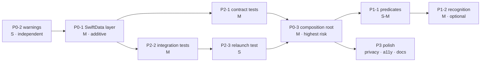

# Implementation and Test Plan

**Status:** **[Proposal]**. No production code has been modified.
Effort is expressed in relative complexity (S / M / L), never in hours.

---

## 1. Baseline — executed during this audit

Everything below must still hold after the work. These are the regression gates.

### 1.1 Build — **[Verified], run**

```bash
xcodebuild build-for-testing \
  -scheme FridgeFit \
  -destination 'platform=iOS Simulator,name=iPhone 17 Pro'
```

→ `EXIT=0`, **0 errors**, **17 warnings** (3 app target, 14 test target).

### 1.2 Tests — **[Verified], run**

```bash
xcodebuild test-without-building \
  -scheme FridgeFit \
  -destination 'platform=iOS Simulator,name=iPhone 17 Pro'
```

→ `EXIT=0`, `Test Suite 'All tests' passed`
→ **Executed 1114 tests, with 4 tests skipped and 0 failures (0 unexpected) in 55.368 seconds**

The 4 skips are the gated model-evaluation harness in
`HybridRecognitionEvaluationTests`.

### 1.3 Firestore rules suite — **[Assumption], not run**

`firestore-tests/` contains an emulator suite (`npm test`). It was **not
executed** during this audit — it requires the Firebase emulator, and starting
it was outside the read-only scope. Its passing status is unverified here.

### 1.4 Destination note

`name=iPhone 17 Pro` is **[Verified]** available (iOS 26.1 runtime). For CI,
prefer the stable id:

```bash
-destination 'platform=iOS Simulator,id=9BF554BB-9167-43BF-8526-6DF291564BC2'
```

A UUID cannot be renamed out from under the script. Only one shared scheme
exists (`FridgeFit.xcscheme`), and it covers both targets.

---

## 2. The four business operations

The rubric asks for at least four meaningful operations with domain-level
errors. **[Verified]** all four already exist. The work is to prove they run
against a real database, and to tighten two of them.

### UC-1 · Add an item to the kitchen

| | |
|---|---|
| Implementation | `UseCases/Inventory/AddInventoryItemUseCase.swift:61-108` → `AddPantryItemUseCase.swift:46-82` |
| Input | `AddInventoryItemRequest` (name, category, storage, `Quantity`, expiry?, opened, threshold?) |
| Output | `(item: PantryItem, event: InventoryEvent)` |
| Validation | positive amount (`:82`); non-blank name (`AddPantryItemUseCase:59`); non-negative quantity (`:62`); **duplicate rejected, not merged** (`:65`) |
| Errors | `AddInventoryItemError.invalidQuantity`, `AddPantryItemError.{emptyIngredientName, invalidQuantity, duplicateIngredient(name:)}` |
| Repositories | `PantryRepository.add`, `InventoryEventRepository.append` |
| Effect | 1 pantry row + 1 `added` event |
| Edge cases | duplicate differing only in case/whitespace (handled by `Ingredient.matches(name:)`); zero quantity allowed by pantry but **not** by kitchen |
| Change needed | **None.** Add SwiftData integration coverage |

### UC-2 · Record using part of an ingredient

| | |
|---|---|
| Implementation | `UseCases/Inventory/RecordIngredientUseUseCase.swift:48-83` |
| Validation | amount > 0; **cannot exceed available**; remainder never negative |
| Errors | `.itemNotFound`, `.invalidUsedAmount`, `.amountExceedsAvailable(available:unit:)` |
| Effect | pantry row updated + 1 `used` event, in that order, so a failed save never leaves an event claiming something that did not happen (`:34-35`) |
| Change needed | **S** — replace `fetchAll().first(where:)` (`:49`) with `fetch(id:)` |

### UC-3 · Record food leaving the kitchen

| | |
|---|---|
| Implementation | `UseCases/Inventory/RecordFoodOutcomeUseCase.swift:75-113` |
| Errors | `RecordFoodOutcomeError.itemNotFound` |
| Effect | pantry row **removed** + 1 `finished`/`discarded`/`deleted` event that **survives the removal** |
| Why it matters here | This is the operation that proves the `.nullify` delete rule (`DATA_MODEL_AND_RELATIONSHIPS.md` §3.1). Under a cascade it would delete its own evidence |
| Change needed | **S** — two `fetchAll().first(where:)` sites (`:76`, `:99`) |

### UC-4 · Identify expiring food

| | |
|---|---|
| Implementation | `UseCases/Inventory/IdentifyExpiringInventoryUseCase.swift:19-73` |
| Validation | pure, synchronous, injectable `now` and `Calendar` — no clock dependency in tests |
| Effect | read-only |
| Change needed | **S** — add a repository-backed variant using `fetchExpiring(before:)`, **keeping the pure function**. The pure policy is the thing that is unit-tested; the predicate is the thing that demonstrates querying. Both should exist |

### A fifth, optional: UC-5 · Persist a recognition session

Only if `DATA_MODEL_AND_RELATIONSHIPS.md` §2.3-2.4 is built. **M.** Writes a
session plus its detections and links confirmed ones to the pantry items they
became. Enables query Q2 and is the most interesting thing in the demo.

---

## 3. Priority roadmap

### P0 — blocks rubric compliance

#### P0-1 · SwiftData entities, mappers and repositories

| | |
|---|---|
| Create | `Data/SwiftData/{PantryItemEntity,InventoryEventEntity,SwiftDataMappers,SwiftDataPantryRepository,SwiftDataInventoryEventRepository,PersistenceContainer}.swift` |
| Modify | none |
| Preserve | every Firestore file |
| Features affected | none yet — nothing constructs these |
| Criterion | Architecture & Persistence (4) |
| Complexity | **M** |
| Regression risk | **None.** Purely additive; existing code cannot reach it |
| Validation | new unit tests on mappers; in-memory container CRUD tests; full suite stays at 1114 passing |
| Rollback | delete the directory |

#### P0-2 · Eliminate the 17 build warnings

| | |
|---|---|
| Modify | `Data/OnlineRecipePreferencesStore.swift:47`, `ViewModels/PantryViewModel.swift:32`, `ViewModels/RecipeViewModel.swift:56-57`, and 5 test files |
| Cause | `SWIFT_DEFAULT_ACTOR_ISOLATION = MainActor` with MainActor types in default-argument expressions |
| Fix | make the default-argument construction explicit at the call site, or mark the in-memory doubles `nonisolated` — the latter matches how `InventoryEvent`, `StorageLocation` and the inventory use cases are already written |
| Criterion | Testing & Code Quality (3); App Store Readiness (4) |
| Complexity | **S** |
| Regression risk | **Low** — isolation annotations, no logic |
| Validation | build log greps to `warnings: 0`; suite stays green |
| Rollback | revert; warnings are not errors |

> Do this **first**. It is the cheapest rubric point in the project, it is
> independent of all other work, and "zero warnings" is a claim a marker can
> check in ten seconds.

#### P0-3 · Composition root and configuration

| | |
|---|---|
| Create | `AppDependencies.swift`, `Data/PersistenceConfiguration.swift` |
| Modify | `FridgeFitApp.swift`; `ContentView.swift:41,82`; **`Views/Support/PantryRepositoryEnvironment.swift:20-22`** |
| Features affected | **all** — this is where the app's dependencies come from |
| Criterion | Architecture & Persistence (4) |
| Complexity | **M** |
| Regression risk | **Medium — the highest in this plan.** Every tab is wired through `ContentView.init()` |
| Validation | full suite; then manual pass over all five tabs in **both** modes; confirm the remote-camera review sheet still reaches a pantry |
| Rollback | revert 3 files; the new files become unreferenced |

> The env-key default is the trap. **[Verified]** at
> `PantryRepositoryEnvironment.swift:21`, a missed edit leaves a live
> `FirestorePantryRepository()` constructor that a SwiftData-mode build can
> still reach through the remote-camera review sheet — writing confirmed
> ingredients to Firestore while the Kitchen tab reads SwiftData. That failure
> is silent and would show up live as "the item I just confirmed isn't in my
> pantry". Grep for `FirestorePantryRepository()` after the change; there should
> be exactly one construction site, inside `AppDependencies`.

### P1 — high-scoring architecture and persistence

#### P1-1 · Domain predicates on the protocol

| | |
|---|---|
| Modify | `Domain/Protocols/PantryRepository.swift` (+2 methods) and **every** conformance: `FirestorePantryRepository`, `InMemoryPantryRepository`, `SwiftDataPantryRepository`, plus test doubles incl. `FailingPantryRepository` |
| Then | UC-2 and UC-3 call `fetch(id:)` instead of scanning |
| Criterion | "meaningful domain predicates and queries" |
| Complexity | **S-M** (mechanical, but touches ~6 files) |
| Regression risk | **Low** — compiler finds every conformance |
| Validation | contract tests (§4.1) assert identical semantics across all three backends |
| Rollback | revert the protocol; call sites return to scanning |

#### P1-2 · Recognition entities

**M**, additive, criterion: relational modelling + "advanced capability"
narrative. Risk low — the pipeline writes a record *after* its existing work
completes; a write failure must not break confirmation, so it is best-effort and
logged, never thrown into the user's path.

### P2 — regression prevention and demonstrability

#### P2-1 · Repository contract test suite — §4.1. **M**, risk none.
#### P2-2 · SwiftData integration tests — §4.2. **M**, risk none.
#### P2-3 · Relaunch-persistence test — §4.3. **S**, the single most convincing test in the set.

### P3 — production polish

| Item | Complexity | Criterion |
|---|---|---|
| `PrivacyInfo.xcprivacy` — **[Verified]** absent, required for submission | **S** | App Store Readiness |
| Accessibility labels — **[Verified]** only 2 in 30,863 lines | **M** | HIG |
| Delete the unused `import FirebaseAuth` at `Views/ProfileView.swift:6` | **XS** | Code quality |
| Architecture diagrams into `README.md` | **S** | Documentation |
| String catalogue — **[Verified]** no localization | **L** | Out of scope; note as future work |

---

## 4. Test design

**[Verified]** the suite is 1,114 XCTest functions in 85 classes, with
`InMemoryPantryRepository` and `FailingPantryRepository` as doubles. The gap is
not coverage of logic — it is that **no test touches a real database**.

### 4.1 Repository contract tests — the keystone

One abstract case, run three times. This is what keeps the Firebase adapter
honest.

```swift
/// Every PantryRepository must behave identically. Subclasses supply the
/// implementation; the assertions are shared, so a backend that diverges
/// fails here rather than in production.
class PantryRepositoryContractTests: XCTestCase {
    /// nil in the abstract base, so it reports no failures of its own.
    func makeRepository() -> (any PantryRepository)? { nil }

    func test_add_thenFetchAll_returnsTheItem() async throws {
        guard let sut = makeRepository() else { return }
        // …
    }

    func test_update_missingItem_throwsItemNotFound() async throws { /* … */ }
    func test_remove_missingItem_throwsPantryItemNotFound() async throws { /* … */ }
    func test_fetchAll_onEmptyStore_returnsEmpty() async throws { /* … */ }
    func test_fetchByID_missing_returnsNil() async throws { /* … */ }
    func test_fetchExpiring_excludesUndatedItems() async throws { /* … */ }
}

final class InMemoryPantryRepositoryContractTests: PantryRepositoryContractTests { /* … */ }
final class SwiftDataPantryRepositoryContractTests: PantryRepositoryContractTests { /* … */ }
// Firestore variant runs against the emulator, skipped when unavailable —
// XCTSkip, never a silent pass.
```

This is how §8 of `RECOMMENDED_ADAPTER_ARCHITECTURE.md` is enforced
mechanically rather than by discipline.

### 4.2 SwiftData integration tests — isolated container per test

```swift
@MainActor
final class SwiftDataPantryRepositoryTests: XCTestCase {
    private var container: ModelContainer!
    private var sut: SwiftDataPantryRepository!

    override func setUp() async throws {
        try await super.setUp()
        // isStoredInMemoryOnly: no file, no leakage between tests, no cleanup
        let configuration = ModelConfiguration(isStoredInMemoryOnly: true)
        container = try ModelContainer(
            for: PantryItemEntity.self, InventoryEventEntity.self,
            configurations: configuration
        )
        sut = SwiftDataPantryRepository(context: container.mainContext)
    }

    override func tearDown() async throws {
        sut = nil; container = nil
        try await super.tearDown()
    }
}
```

Coverage to add:

| # | Test | Proves |
|---|---|---|
| 1 | add → fetchAll round-trips every field | mapping completeness incl. all six optional kitchen fields |
| 2 | add → update → fetch reflects the change | change tracking, `apply(_:to:)` not re-inserting |
| 3 | remove missing id throws `RemovePantryItemError.pantryItemNotFound` | error parity with Firestore |
| 4 | update missing id throws `UpdatePantryItemError.itemNotFound` | error parity |
| 5 | fetchAll on an empty store returns `[]`, does not throw | empty-state handling |
| 6 | **delete an item with events → events survive with `item == nil`** | the `.nullify` rule, i.e. UC-3 correctness |
| 7 | delete a recognition session → its detections are gone | the `.cascade` rule |
| 8 | two items with the same `id` → unique constraint rejects | identity |
| 9 | `fetchExpiring(before:)` excludes undated items | predicate semantics match the pure use case |
| 10 | **relaunch persistence** — §4.3 | the actual rubric requirement |

### 4.3 The relaunch test

A single test that is worth more than the other nine to a marker, because it is
the one thing an in-memory double can never fake:

```swift
func test_dataSurvivesContainerRecreation() async throws {
    let url = URL.temporaryDirectory.appending(path: "relaunch-\(UUID()).store")
    defer { try? FileManager.default.removeItem(at: url) }
    let configuration = ModelConfiguration(url: url)   // on disk, not in memory

    // "Launch 1"
    let first = try ModelContainer(for: PantryItemEntity.self, configurations: configuration)
    try await SwiftDataPantryRepository(context: first.mainContext).add(milk)

    // "Launch 2" — a brand-new container over the same file
    let second = try ModelContainer(for: PantryItemEntity.self, configurations: configuration)
    let items = try await SwiftDataPantryRepository(context: second.mainContext).fetchAll()

    XCTAssertEqual(items.map(\.id), [milk.id])
}
```

A real file in a temp directory, deleted on teardown. This is the automated form
of demo step 4-5 in `PRESENTATION_EVIDENCE_PLAN.md`.

### 4.4 Use-case tests against a real store

The **[Verified]** existing `InventoryUseCaseTests` (433 lines) run against
`InMemoryPantryRepository`. Keep every one of them, and add a parallel run of
the highest-value cases against SwiftData — particularly UC-3, where the
interaction between "remove the item" and "keep the event" is a *database*
behaviour that an array-backed double cannot test.

### 4.5 Regression protection for existing features

| Area | Protection |
|---|---|
| Remote camera / WebRTC | **Do not modify.** `WebRTCSessionCoordinatorTests` (716 lines), `WebRTCLoopbackTests` (431) must stay green |
| Recognition | `YOLOFoodDetectionServiceTests`, `DetectionFusionServiceTests` unchanged |
| Firestore mapping | 3 mapping suites unchanged |
| Recommendations | `GenerateContextAwareRecommendationsUseCaseTests` (509 lines) unchanged |

**Rules for this work, non-negotiable:** no test is deleted; no assertion is
weakened to make a failure go away; a test that cannot run is `XCTSkip`-ed with
a reason, never quietly passed.

### 4.6 Not proposed

**UI tests.** There is **[Verified]** no UI test target. Adding one is a new
target, a new scheme, and a slow flaky suite. The rubric's testing criterion
asks for domain unit tests with mock repositories, which is already exceeded.
Out of scope — stated so the omission is a decision, not an oversight.

---

## 5. Sequencing



The ordering rule: **the riskiest step, P0-3, happens only after the SwiftData
layer is tested in isolation.** Wiring an unproven store into every tab and then
debugging both at once is how a working app gets broken the week before a demo.

---

## 6. Overall rollback

Every change is on a feature branch. The escape hatches, cheapest first:

1. **Flip the configuration** to `.firebase` — the app behaves exactly as it
   does today, with no code revert.
2. **Revert the 3 modified files** — SwiftData becomes unreachable dead code.
3. **Delete `Data/SwiftData/`** — full removal.

No step requires touching Firestore data, security rules, or the remote-camera
subsystem.

---

## 7. Unresolved questions

1. Should the Firestore contract test run against the emulator in CI, or be
   skipped by default? Running it is better evidence; it needs the emulator in
   the pipeline.
2. Is P1-2 (recognition entities) in or out? It is the most interesting work and
   the easiest to cut.
3. Does the team want `ownerUserID` scoping in v1
   (`RECOMMENDED_ADAPTER_ARCHITECTURE.md` §7.1)?
