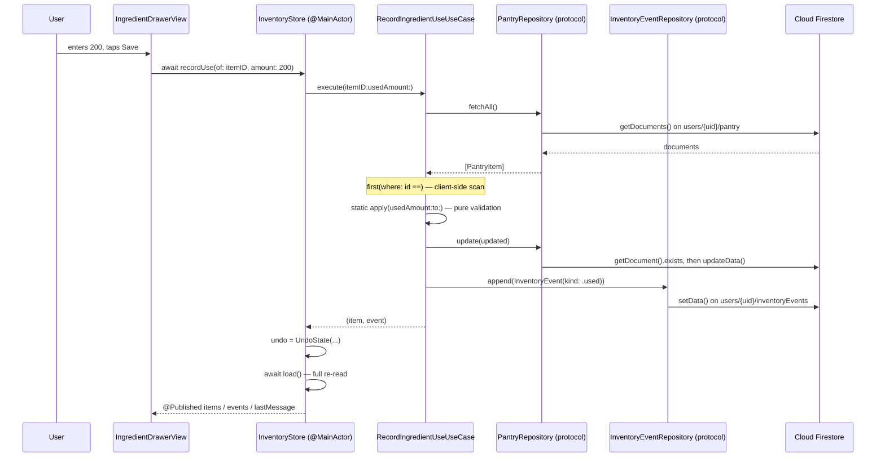

# Persistence Architecture Audit

**Audit date:** 2026-10-17
**Repository state:** branch `docs/assessment4-persistence-audit`, cut from `main` at `34a9b85`
**Toolchain observed:** Xcode 26.1 (17B55), `IPHONEOS_DEPLOYMENT_TARGET = 26.0`, `SWIFT_VERSION = 5.0`

Every claim marked **[Verified]** was read out of the repository or produced by a
command run during this audit; the command and its output are named. Claims
marked **[Assumption]** are inferences that have not been executed or proven.
**[Proposal]** marks design work, not current behaviour.

---

## 0. Headline finding

> **[Verified]** FridgeFit contains **no native persistence of any kind**. There
> is no SwiftData, no Core Data, and no CloudKit anywhere in the repository.

Evidence — a repository-wide grep returned zero matches:

```
grep -rn "import SwiftData\|import CoreData\|@Model\b\|NSManagedObject\|\
NSPersistentContainer\|ModelContainer\|CloudKit" --include="*.swift" .
→ (no output)
```

Everything the user owns — pantry, kitchen history, saved recipes — is stored in
Cloud Firestore and nowhere else. This single gap is the only *structural*
rubric requirement the project fails. The architectural scaffolding the rubric
asks for around it (MVVM, use cases, repository protocols, domain errors, mock
repositories) is already present and is of good quality, which is the central
conclusion of this audit and the reason the recommended change is small.

---

## 1. Scale of the codebase

**[Verified]** via `find … -name "*.swift" | xargs wc -l`:

| Area | Files | Lines |
|---|---:|---:|
| App target (`FridgeFit/`) | 205 | 30,863 |
| Test target (`FridgeFitTests/`) | 92 | 19,444 |

**[Verified]** Test suite composition, via `grep -rE "^\s*func test[A-Za-z0-9_]*\("`:

- **1,114** test functions across **85** `XCTestCase` classes.
- **0** uses of the Swift Testing framework (`import Testing` → no matches); the
  suite is entirely XCTest.

This matters for the rubric: the "at least five meaningful automated domain unit
tests using mock repositories" floor is already cleared by a wide margin. The
testing gap is not *quantity*, it is that **no test exercises a real database**,
because there is no real database to exercise.

---

## 2. App entry point and dependency initialization

### 2.1 `FridgeFitApp` — process bootstrap only

**[Verified]** `FridgeFit/FridgeFitApp.swift:12-38`. The `@main` entry does three
things: `FirebaseApp.configure()` (line 17), Google Sign-In client configuration
(lines 18-20), and an auth-gated root view switch (lines 26-30). It constructs
**no repositories**.

### 2.2 `ContentView.init()` — the de-facto composition root

**[Verified]** `FridgeFit/ContentView.swift:40-133`. This single initializer is
where every dependency in the authenticated app is wired. It is a genuine
composition root in all but name: eight view models are built here, each handed
its collaborators by constructor injection.

The two lines that decide the persistence backend for the entire app:

```swift
// ContentView.swift:41
let pantryRepository = FirestorePantryRepository()

// ContentView.swift:82
eventRepository: FirestoreInventoryEventRepository()
```

**This is the most important structural fact in the audit.** Because every
feature receives its repository by injection from these two lines, swapping the
persistence backend is a change at *two call sites*, not a change spread through
the UI.

### 2.3 A second, easily-missed backend selection point

**[Verified]** `FridgeFit/Views/Support/PantryRepositoryEnvironment.swift:20-22`:

```swift
private struct PantryRepositoryKey: @preconcurrency EnvironmentKey {
    @MainActor static let defaultValue: any PantryRepository = FirestorePantryRepository()
}
```

The SwiftUI environment key's **default value constructs a Firestore repository
directly**. `ContentView` does inject the real instance over it
(`ContentView.swift:190`), so in normal operation this default is unused — the
file's own doc comment explains it is deliberately a real repository so a missed
injection fails loudly rather than silently writing into a dictionary.

That reasoning is sound today, but it means **a backend switch must change two
files, not one**. Any adapter work that changes only `ContentView` will leave a
live Firestore constructor reachable here. Flagged as a concrete P1 item.

---

## 3. Layering: what is actually implemented

The rubric asks for MVVM + Use Case + Repository with clean separation. This
audit checked behaviour, not directory names.

### 3.1 Domain models are framework-free — **[Verified]**

`PantryItem` (`Domain/Models/PantryItem.swift:25`), `InventoryEvent`
(`Domain/Models/Inventory/InventoryEvent.swift:69`), `Ingredient`
(`Domain/Models/Ingredient.swift:11`), `Recipe` (`Domain/Models/Recipe.swift:46`)
and `RecipeIngredient` (`Domain/Models/RecipeIngredient.swift:32`) are all plain
`struct`s importing only `Foundation`. None imports Firebase. None is a
Firestore document wrapper.

**This is the finding that makes the whole recommended plan cheap.** A SwiftData
adapter can be added without touching a single domain type, because the domain
is already independent of its storage.

### 3.2 Repository protocols are domain-shaped — **[Verified]**

Four protocols exist in `Domain/Protocols/`:

| Protocol | File | Operations |
|---|---|---|
| `PantryRepository` | `PantryRepository.swift:12` | `fetchAll`, `add`, `update`, `remove(id:)` |
| `InventoryEventRepository` | `InventoryEventRepository.swift:15` | `fetchAll(limit:)`, `append`, `remove(ids:)` |
| `SavedRecipeRepository` | `SavedRecipeRepository.swift:24` | refines `RecipeRepository`; `save(_:sourceRecipeID:)`, `remove(id:)` |
| `RecipeRepository` | `RecipeRepository.swift:14` | `fetchAll` |

These are not a generic `CRUDRepository<T>`. `InventoryEventRepository` is
append-only by deliberate design — its doc comment states "history that can be
rewritten isn't history" (`InventoryEventRepository.swift:20-21`). That is a
domain decision expressed in a protocol signature, which is exactly what the
rubric's "protocol-based repository abstractions" criterion is asking for.

### 3.3 Use cases carry real business rules — **[Verified]**

Sampled and read in full:

- `AddPantryItemUseCase.execute` (`UseCases/AddPantryItemUseCase.swift:46-82`) —
  trims and rejects blank names (line 59), rejects negative quantity (line 62),
  and **rejects duplicates rather than merging** (lines 65-67), with the
  reasoning documented at lines 23-27.
- `RecordIngredientUseUseCase.execute` (`UseCases/Inventory/RecordIngredientUseUseCase.swift:48-64`)
  — fetch, apply, persist, record, in that order, so "a failure to save never
  leaves a `used` event claiming something that didn't happen" (lines 34-35). The
  pure arithmetic is split into a `static apply` (line 70) testable with no
  storage.
- `RecordFoodOutcomeUseCase` (`UseCases/Inventory/RecordFoodOutcomeUseCase.swift:61-113`)
  — removes the item and writes a `finished`/`discarded` event, with a separate
  `deleteRecord` entry point (line 98) so "this row was wrong" never lands in the
  same bucket as "we ate it".
- `IdentifyExpiringInventoryUseCase` (`UseCases/Inventory/IdentifyExpiringInventoryUseCase.swift:19-73`)
  — pure, synchronous, no repository, fully testable.

### 3.4 Domain errors exist and are user-facing — **[Verified]**

`Domain/Errors/` holds 13 error types. Sampled: `AddPantryItemError`
(`.emptyIngredientName`, `.invalidQuantity`, `.duplicateIngredient(name:)`),
`RecordIngredientUseError` (`.itemNotFound`, `.invalidUsedAmount`,
`.amountExceedsAvailable(available:unit:)`), `PantryRepositoryError`
(`.notAuthenticated`). All conform to `LocalizedError` with messages written for
users, not developers.

### 3.5 ViewModels do not touch storage frameworks — **[Verified]**

`InventoryStore` (`ViewModels/InventoryStore.swift:36-326`) imports only `Combine`
and `Foundation`. It holds two repository protocol references and five use cases,
and every mutation routes through a use case. Its doc comment records that an
earlier branch's `InventoryService` wrote JSON to Application Support and that
this was deliberately removed (lines 11-20).

### 3.6 View ↔ Firebase coupling — **[Verified], one instance, cosmetic**

Only one file under `Views/` imports Firebase:

```
FridgeFit/Views/ProfileView.swift:6 → import FirebaseAuth
```

Reading the file (lines 12-53), **the import is unused** — the view reads
`authViewModel.user?.email` through `@EnvironmentObject` and calls
`authViewModel.signOut()`. No `Auth.` symbol appears in the body.

So the direct View→Firestore coupling the audit brief asked about **does not
exist**. There is one stale import to delete. That is a code-quality nit, not an
architectural defect.

### 3.7 Summary of layering

| Rubric element | State | Evidence |
|---|---|---|
| MVVM | **Implemented** | 15 view models in `ViewModels/`, all `ObservableObject` |
| Use Case layer | **Implemented** | 30 use-case files, real validation + domain errors |
| Repository pattern | **Implemented** | 4 protocols, Firestore + in-memory implementations |
| Views isolated from storage | **Implemented** | 1 unused import is the only breach |
| Native persistence | **ABSENT** | §0 |

---

## 4. Firebase surface area

**[Verified]** Firebase is imported by exactly **9 app files**:

| File | Service | Role |
|---|---|---|
| `FridgeFitApp.swift` | FirebaseCore | `configure()` at launch |
| `AuthViewModel.swift` | FirebaseAuth | sign-in/up/out, Google credential, auth-state listener |
| `Views/ProfileView.swift` | FirebaseAuth | **unused import** |
| `Data/FirestorePantryRepository.swift` | Firestore + Auth | pantry CRUD |
| `Data/FirestoreInventoryEventRepository.swift` | Firestore + Auth | event log |
| `Data/FirestoreSavedRecipeRepository.swift` | Firestore + Auth | saved recipes |
| `Data/RemoteCamera/FirestoreDeviceRegistry.swift` | Firestore + Auth | device presence |
| `Data/RemoteCamera/FirestoreSignalingTransport.swift` | Firestore + Auth | WebRTC signalling |
| `Data/RemoteCamera/FirestoreDiagnostics.swift` | Firestore | diagnostics |

Seven of the nine are in `Data/`. The containment is good.

### 4.1 Firestore schema in use

**[Verified]** from `firestore.rules:13-18` and cross-checked against the
repository implementations:

```
users/{uid}/pantry/{pantryItemId}
users/{uid}/inventoryEvents/{eventId}
users/{uid}/savedRecipes/{recipeId}
users/{uid}/devices/{deviceId}
users/{uid}/webrtcSessions/{sessionId}
users/{uid}/webrtcSessions/{sessionId}/callerCandidates/{candidateId}
users/{uid}/webrtcSessions/{sessionId}/calleeCandidates/{candidateId}
```

Single security boundary: `request.auth.uid == uid` (`firestore.rules:33-35`).

### 4.2 Real-time Firestore usage — **[Verified]**

Snapshot listeners and transactions exist **only** in the remote-camera subsystem:

| Location | API |
|---|---|
| `FirestoreDeviceRegistry.swift:130` | `addSnapshotListener` (device presence) |
| `FirestoreSignalingTransport.swift:115` | `runTransaction` (offer/answer claim) |
| `FirestoreSignalingTransport.swift:176` | `addSnapshotListener` (session doc) |
| `FirestoreSignalingTransport.swift:222` | `addSnapshotListener` (ICE candidates) |
| `FirestoreSignalingTransport.swift:267` | `addSnapshotListener` (session query) |

**The three business-data repositories use no listeners at all** — they are
one-shot `getDocuments()` / `setData()` / `updateData()` calls. `InventoryStore`
re-reads after every write by design (`InventoryStore.swift:29-35`).

This is a decisive input to the design: **the pantry has no real-time
requirement to preserve.** Replacing its backend costs no live-update behaviour,
because there is none. The remote camera, by contrast, is built *on* real-time
primitives and must not be touched.

### 4.3 Encode/decode is already pure and unit-tested — **[Verified]**

All three business repositories factor their field mapping into `static`
functions with no Firestore instance (`FirestorePantryRepository.swift:73-183`,
`FirestoreInventoryEventRepository.swift:72-114`,
`FirestoreSavedRecipeRepository.swift:55-78`), tested by
`FirestorePantryRepositoryMappingTests`, `FirestoreInventoryMappingTests` and
`FirestoreSavedRecipeRepositoryMappingTests` without a live project.

A SwiftData adapter should copy this pattern exactly: pure mapping functions,
separately tested.

---

## 5. Feature-by-feature persistence inventory

**[Verified]** by reading each named implementation.

| # | Feature | Where stored today | Real-time? | Survives offline? |
|---|---|---|---|---|
| 1 | Pantry items | Firestore `users/{uid}/pantry` | No | Firestore SDK cache only |
| 2 | Inventory events | Firestore `users/{uid}/inventoryEvents` | No | Firestore SDK cache only |
| 3 | Saved recipes | Firestore `users/{uid}/savedRecipes` — **gated off** | No | n/a |
| 4 | Bundled recipes | Compiled-in (`BundledRecipeRepository.swift`) | No | Yes |
| 5 | Online recipe results | In-memory cache (`OnlineRecipeCacheStore.swift`) | No | No |
| 6 | Online recipe preferences | `UserDefaults` (`OnlineRecipePreferencesStore.swift`) | No | Yes |
| 7 | Device identity | `UserDefaults` (`RemoteCamera/DeviceIdentity.swift`) | No | Yes |
| 8 | Device presence | Firestore `users/{uid}/devices` + listener | **Yes** | No |
| 9 | WebRTC signalling | Firestore `webrtcSessions` + listeners + transaction | **Yes** | No |
| 10 | Ingredient recognition results | **Not persisted** — in-flight only | No | n/a |
| 11 | Auth identity | Firebase Auth SDK keychain | listener | Yes |
| 12 | Substitution results | In-memory (`SubstitutionCache.swift`) | No | No |

**[Verified]** Item 3 is switched off: `OnlineRecipeFeature.savedRecipeStorage`
is `.disabledPendingRulesDeployment` because the `savedRecipes` rules block
exists in `firestore.rules:65-80` but **is not deployed**. `ContentView.swift:50`
therefore receives `nil` and the save action is never offered.

**[Verified]** Item 10 is the notable one: ingredient recognition — the YOLO +
Vision + fusion pipeline, which is the app's headline capability — **persists
nothing**. Detections flow from `SnapshotIngredientAnalyzer` through
`IngredientReviewViewModel` to `AddDetectedIngredientsUseCase`, which writes
`PantryItem`s. The detection record itself (what was seen, with what confidence,
when) is discarded.

---

## 6. Data-flow trace: "user records using 200 g of chicken"

**[Verified]** by reading the call chain end to end.



Two observations that feed the design work:

1. **[Verified]** The layering holds all the way down — the view never names a
   storage type, and the use case never names Firestore.
2. **[Verified]** `UseCases/Inventory/RecordIngredientUseUseCase.swift:49` finds
   one item by fetching the **whole collection** and scanning it client-side:
   `try await pantryRepository.fetchAll().first(where: { $0.id == itemID })`. The
   same pattern appears in `RecordFoodOutcomeUseCase.swift:76` and `:99`, and
   `AddPantryItemUseCase.swift:65` scans the whole pantry for a duplicate.

Point 2 is both a mild inefficiency and a rubric opportunity: the protocol has no
by-identifier or by-predicate read, so there is nowhere for a "meaningful domain
predicate" to live. Adding one narrow query method is the cheapest way to satisfy
that criterion honestly. See `RECOMMENDED_ADAPTER_ARCHITECTURE.md` §4.

---

## 7. Build and test execution evidence

### 7.1 Build — **[Verified], succeeds, but is NOT warning-free**

```
xcodebuild build-for-testing -scheme FridgeFit \
  -destination 'platform=iOS Simulator,name=iPhone 17 Pro'
→ EXIT=0
→ errors:   0
→ warnings: 17
```

All 17 are the same class of diagnostic, caused by
`SWIFT_DEFAULT_ACTOR_ISOLATION = MainActor` combined with default-argument
expressions and `static let` defaults evaluated in nonisolated contexts.

**App target — 3 warnings:**

| File:line | Warning |
|---|---|
| `Data/OnlineRecipePreferencesStore.swift:47:50` | main actor-isolated static property `default` referenced from nonisolated context |
| `ViewModels/PantryViewModel.swift:32:47` | main actor-isolated initializer `init(seedItems:)` in synchronous nonisolated context |
| `ViewModels/RecipeViewModel.swift:56:46`, `:57:46` | same, `init(recipes:)` / `init(seedItems:)` |

**Test target — 14 warnings**, in `RecipeViewModelSavedRecipesTests.swift:28-29`,
`SpoonacularRecipeServiceTests.swift:62`, `ScanReceiptUseCaseTests.swift:13-14`,
`ReceiptScannerViewModelTests.swift:15,16,33`.

The rubric asks for "clean builds with zero warnings/errors". **This is
currently a fail**, it is cheap to fix, and it is unrelated to persistence. See
`IMPLEMENTATION_AND_TEST_PLAN.md` P0-2.

### 7.2 Project configuration — **[Verified]**

| Setting | Value | Rubric relevance |
|---|---|---|
| `IPHONEOS_DEPLOYMENT_TARGET` | **26.0** | SwiftData (iOS 17+) fully available, no back-deployment concern |
| `SWIFT_VERSION` | 5.0 | Swift 5 language mode; Swift 6 not enforced |
| `SWIFT_APPROACHABLE_CONCURRENCY` | YES | source of the 17 warnings |
| `SWIFT_DEFAULT_ACTOR_ISOLATION` | MainActor | types are MainActor by default unless marked `nonisolated` |
| `ENABLE_USER_SCRIPT_SANDBOXING` | YES | — |
| Targets | `FridgeFit`, `FridgeFitTests` | **no UI test target, no widget extension** |
| Shared schemes | `FridgeFit.xcscheme` only | — |

Package dependencies: firebase-ios-sdk ≥ 11.0.0, GoogleSignIn-iOS ≥ 7.0.0,
stasel/WebRTC ≥ 154.0.0.

### 7.3 Advanced platform capability — **[Verified], already satisfied**

The rubric wants at least one of WidgetKit / CoreML / Foundation Models / system
extension. FridgeFit has **two**, both real:

- **CoreML** — `Resources/YOLO11n.mlpackage` and
  `Resources/FridgeFitIngredients.mlpackage`, driven by
  `Data/RemoteCamera/YOLOFoodDetectionService.swift` and
  `AppleVisionIngredientClassifier.swift`.
- **Foundation Models** — `Data/AppleReceiptIngredientInterpreter.swift` and
  `AppleRecipeSuggestionService.swift`, gated by
  `Domain/Models/AppleIntelligenceAvailability.swift`.

No work is needed for this criterion.

### 7.4 Test run — **[Verified], executed during this audit**

```
xcodebuild test-without-building -scheme FridgeFit \
  -destination 'platform=iOS Simulator,name=iPhone 17 Pro'
→ EXIT=0
→ Test Suite 'All tests' passed
→ Executed 1114 tests, with 4 tests skipped and 0 failures (0 unexpected)
   in 55.368 seconds
```

The 4 skipped tests are all in `HybridRecognitionEvaluationTests`
(`test_measureEveryCandidateOnTheSharedSet`,
`test_swiftReproducesThePythonFullImageMeasurement`,
`test_visionCoversCategoriesTheDetectorCannot`,
`test_visionOutperformsTheDetectorOnThisSet`) — the model-evaluation harness,
which is gated rather than run on every build.

**This is a genuinely green suite**, and it is the baseline any persistence work
must not regress. No test is reported as passing anywhere in this audit set that
was not actually executed by the command above.

---

## 8. App Store readiness gaps found incidentally

**[Verified]**

- **No privacy manifest.** `find . -name "PrivacyInfo.xcprivacy"` → no results.
  Required for App Store submission, and the app uses `UserDefaults` (a declared
  reason API) plus third-party SDKs.
- **Accessibility is thin.** Across 30,863 lines of app code there are
  **2** `accessibilityLabel` call sites. The camera overlay, ingredient tiles and
  detection UI are largely unlabelled.
- **No localization.** No `.strings` or `.xcstrings` catalogue; all user-facing
  copy is inline English literals.
- `NSCameraUsageDescription` **is** present and well written
  (`FridgeFit/Info.plist:14-15`). `PhotosPicker` is used
  (`RemoteCameraView.swift:159, 264`) — the modern `PhotosPicker` does not require
  `NSPhotoLibraryUsageDescription`, so its absence is **[Verified] correct**, not
  a gap.

---

## 9. Unresolved questions

1. **No assessment brief is in the repository.** `find` for
   `*assess*`/`*rubric*`/`*criteri*`/`*marking*` returned only Python
   dependencies. Every rubric statement in this audit set is taken from the
   task description supplied to the auditor and **could not be verified against a
   source document**. If a PDF/DOCX brief exists, it should be added to the repo
   and the gap analysis re-checked against it.
2. **Is the live presentation demo run on a device or the simulator?** The
   remote-camera feature needs two physical iPhones; the SwiftData demo does not.
   This changes the demo script.
3. **Will `savedRecipes` rules be deployed before submission?** This decides
   whether `SavedRecipe` is available as a third entity for the relational model.

---

## 10. Conclusion

The project does not need an architecture. It has one, and it is better than
most of what this rubric is written to detect. What it lacks is a **native
persistence implementation behind the protocols that already exist**, plus a
handful of production-readiness items that have nothing to do with persistence.

The recommended work is therefore additive, not a refactor. See
`COREDATA_VS_SWIFTDATA_DECISION.md` for the backend choice and
`RECOMMENDED_ADAPTER_ARCHITECTURE.md` for the design.
