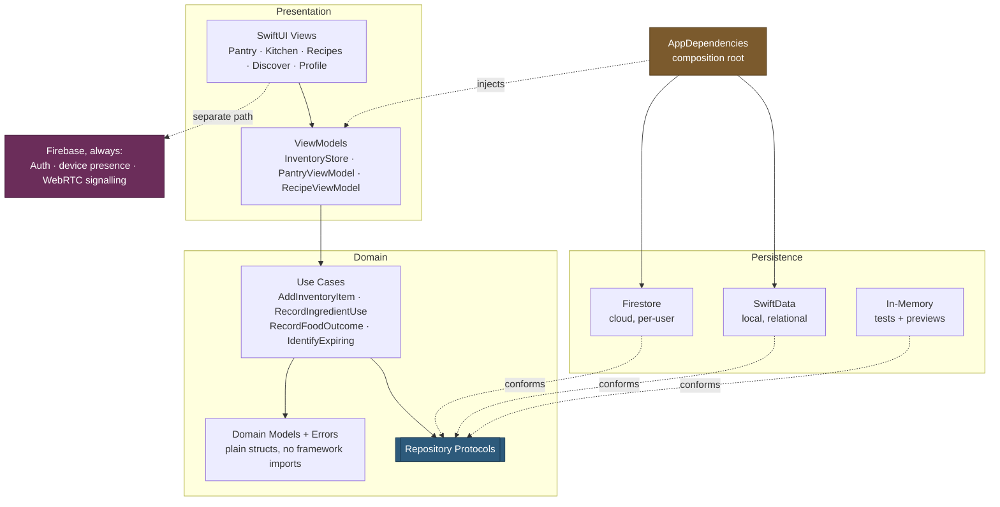
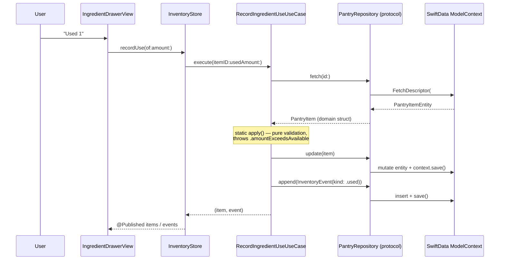

# Presentation and Evidence Plan

Covers the live demonstration, the diagrams to prepare, and the evidence to put
in the Required Document. 10 of 30 marks are the presentation —
**[Verified]** more than the architecture, testing and readiness criteria
combined (11).

---

## 1. One-page architecture diagram

**The sentence to say over it:** *"Three storage implementations satisfy one
protocol. Everything above that protocol — every view, every view model, every
use case — is identical whichever one is selected."*

---

## 2. Live demonstration script

Nine steps, ~4 minutes. Each step names what it proves.

| # | Action | Proves | Risk |
|---|---|---|---|
| 1 | Launch in SwiftData mode (scheme argument `-persistence swiftData`) | Native persistence is the running configuration | None — no network needed |
| 2 | Kitchen tab → add "Greek Yogurt", 2 pcs, Fridge, expires in 2 days | A business operation through use case → protocol → SwiftData | Low |
| 3 | Try adding "greek yogurt" again → duplicate error appears | A **domain error** from a use case, with case-insensitive matching | Low |
| 4 | **Stop the app from Xcode** (not background — terminate) | Sets up the only proof that matters | None |
| 5 | Relaunch. Yogurt is still there, **with Wi-Fi off** | **Data is on the device, not in a cloud cache.** The core claim | None — strongest step |
| 6 | Record using 1 pc → amount drops, activity log shows "Used 1 pcs" | Multi-entity write: item updated *and* event appended | Low |
| 7 | Finish the item → it leaves the pantry, **history survives** | The `.nullify` delete rule. Say: *"cascade here would delete the record of the thing that just happened"* | Low |
| 8 | "Use First" section ordered by expiry | A real `#Predicate` + two-key sort, not client-side filtering | Low |
| 9 | Switch the scheme to `-persistence firebase`, relaunch, show the cloud pantry | The Firebase adapter is **alive**, and the two stores are genuinely separate | Medium — needs network + sign-in |

### Rules for the demo

- **Step 5 is the whole demonstration.** If time collapses, do 1, 2, 4, 5, 7.
- **Turn Wi-Fi off before step 5, visibly.** It converts "it persisted" into
  "it persisted *locally*" and pre-empts the obvious challenge: *was that just
  Firestore's offline cache?*
- **Never say "switching modes syncs the data."** It does not
  (`FIREBASE_COMPATIBILITY_AND_ROLLBACK.md` §4). Say: *"two separate stores,
  one protocol, selected at the composition root."*
- Step 9 is the only networked step. Put it last so a network failure costs
  nothing already shown.

---

## 3. Data-flow trace to narrate

One user tap, all the way down. Keep this on a slide for step 6.

**The line to say:** *"The use case names no storage type. Swap SwiftData for
Firestore and this diagram changes in exactly one box."*

---

## 4. Firebase vs SwiftData responsibilities

A slide that answers "why keep both?" before it is asked.

| Responsibility | SwiftData | Firebase | Why |
|---|---|---|---|
| Pantry items | ✅ selected | ✅ selected | Either; one at a time |
| Inventory events | ✅ selected | ✅ selected | Must match the pantry |
| Relational integrity, delete rules | ✅ | ❌ | Firestore enforces none |
| Type-checked queries | ✅ `#Predicate` | ❌ string fields | |
| Offline, no account | ✅ | ⚠️ SDK cache only | |
| Multi-device | ❌ | ✅ | Local store is device-scoped |
| Per-user security rules | ❌ | ✅ `users/{uid}` | A local file has no auth boundary |
| **WebRTC signalling** | ❌ **impossible** | ✅ | Two devices share no local store |
| **Device presence** | ❌ **impossible** | ✅ | A heartbeat's audience is another phone |
| **Authentication** | ❌ | ✅ | Firebase Auth owns identity |
| Recognition history | ✅ | ❌ | New capability; no cloud schema exists |

**The trade-off sentence:** *"We did not choose local over cloud. We separated
data that belongs to one device from infrastructure that only exists between
two, and made the first part swappable."*

---

## 5. Seven-minute group presentation — technical portion (~90 seconds)

> "FridgeFit was built on Firebase. For this assessment we added native
> persistence — but the interesting part is what we *didn't* have to change.
>
> The app already had repository protocols, and domain models that were plain
> Swift structs with no framework imports. So adding SwiftData meant writing
> new implementations of protocols that already existed. Thirty thousand lines
> of views, view models and use cases are untouched — not refactored,
> untouched.
>
> The schema is relational, and one delete rule is load-bearing. Finishing a
> carton of milk removes the pantry item and writes an event saying it was
> finished. If events cascaded from items, that delete would erase the record
> of the thing that just happened — so the rule is nullify, and the history
> outlives the food.
>
> We deliberately did **not** build synchronisation. The rubric asks for native
> persistence, not sync, and the app has no real-time requirement in its
> business data — we checked: zero snapshot listeners in the pantry code. What
> does need real time is the remote camera, where two phones negotiate a WebRTC
> connection. A local database cannot do that, so it stayed on Firebase.
>
> [demo steps 1-7]
>
> That survived a terminate and a relaunch with Wi-Fi off. It's on the device."

**Timing:** ~90 s narration + ~4 min demo. Cut the sync paragraph first if over.

---

## 6. Technical-hurdle narrative — real, with numbers

**[Verified]** from `docs/`. Do not invent hurdles; these are documented, dated
and measured.

### Hurdle A — a Simulator-only failure that killed the whole pipeline

**[Verified]** `docs/simulator-classification-fallback.md`, 14 Oct 2026.

`VNClassifyImageRequest` cannot run in the iOS Simulator, failing with
`Failed to create espresso context`. The limitation was already known and
reproduced in 20 lines containing no FridgeFit code. What was *not* handled was
the blast radius: in `SnapshotIngredientAnalyzer.analyze` the detector
succeeded, then the classifier threw, and **the whole analysis returned
nothing** — so a working detector produced an empty screen.

**Why it's a good story:** the bug was not in the code that failed. It was in
the code that assumed a partial failure was a total one. The fix degrades
gracefully instead of propagating.

### Hurdle B — choosing a fusion rule by measurement, not intuition

**[Verified]** `docs/hybrid-stage2-results.md`, 13 Oct 2026.

Four conflict-resolution strategies measured over the same 11 annotated images.
When detector and classifier disagree about a region, the classifier is right
**5 times in 8**, the detector **1 in 8**. Preferring the classifier raised
recall **50.0% → 57.9%** and precision **51.4% → 56.4%**.

**Why it's a good story:** the honesty. The result is still marked *uncertain*
in the UI, "because 5 of 8 is not 8 of 8". That is a team that measured its
own confidence and then told the user about it.

### Hurdle C — a fix that deleted its own evidence

**[Verified]** same document.

OCR read `ICE CREAM` and matched it to `cream_carton`. The fix worked — and
removed the only match the evaluation set produced. So automatic
OCR-to-ingredient matching was switched **off by default**: reading text works,
turning text into an ingredient is not demonstrated, and the lines are shown to
the user instead of guessed at.

**Why it's a good story:** shipping a capability switched off because the
evidence for it was gone is the opposite of the usual student instinct.

### Hurdle D — persistence (the one this audit creates)

Available after the work: the `.nullify` vs `.cascade` decision, discovered by
tracing what `RecordFoodOutcomeUseCase` actually does rather than by picking a
default. Pairs naturally with demo step 7.

---

## 7. Evidence for the Required Document

| Evidence | Source | Status |
|---|---|---|
| Architecture diagram | §1 | Ready |
| ER diagram | `DATA_MODEL_AND_RELATIONSHIPS.md` §3 | Ready |
| Data-flow trace | §3, and audit §6 for the Firestore path | Ready |
| Firebase/SwiftData responsibility split | §4 | Ready |
| Repository protocol listing | `Domain/Protocols/` | **[Verified]** exists |
| Four business operations + errors | `IMPLEMENTATION_AND_TEST_PLAN.md` §2 | **[Verified]** exists |
| Test-run screenshot | 1114 passed / 4 skipped / 55.4 s | **[Verified] executed** |
| Zero-warning build screenshot | — | **Blocked:** 17 warnings until P0-2 |
| Relational query examples | `DATA_MODEL_AND_RELATIONSHIPS.md` §5 | Ready |
| Decision matrix | `COREDATA_VS_SWIFTDATA_DECISION.md` §3 | Ready |
| Technical hurdles with measurements | §6 | **[Verified]** in `docs/` |
| Privacy/security posture | `firestore.rules`, `Info.plist`, `Secrets.xcconfig` | **[Verified]**, minus the privacy manifest |

---

## 8. Questions a marker is likely to ask

| Question | Answer |
|---|---|
| "Is that just Firestore's offline cache?" | Wi-Fi was off *and* the Firebase path was not selected. Show the launch argument. (This is why step 5 turns Wi-Fi off visibly.) |
| "Why keep Firebase at all?" | Auth, multi-device, and WebRTC signalling, which a local store cannot do at all — §4 |
| "Do the two stores sync?" | **No**, by design. One source of truth per mode. Sync earns no marks and risks data loss — `COREDATA_VS_SWIFTDATA_DECISION.md` §6 |
| "Why SwiftData over Core Data?" | Same marks, less code, compiler-checked predicates. Deployment target is iOS 26, so there is no back-deployment argument for Core Data — §3 of the decision doc |
| "Why not CloudKit?" | `@Attribute(.unique)` is unsupported with CloudKit, and it would put a second sync system beside Firebase |
| "Is your local store per-user?" | **No.** It is device-scoped. Firestore is per-user via `users/{uid}`. — `RECOMMENDED_ADAPTER_ARCHITECTURE.md` §7.1 |
| "Show me a relational query." | Demo step 8, then the code — `#Predicate` with a two-key sort |

**On the last two: answer the limitation straight.** A team that states what its
design does not do is more credible than one that is caught not knowing.

---

## 9. Unresolved questions

1. **Device or simulator?** The remote camera needs two physical iPhones; the
   persistence demo needs neither. If both are shown, who holds the second
   phone?
2. **Who presents the technical portion?** §5 is ~90 seconds of one person's
   time within a 7-minute group slot.
3. **Is the Required Document's format specified?** Unknown — the brief is
   **[Verified]** not in the repository.
