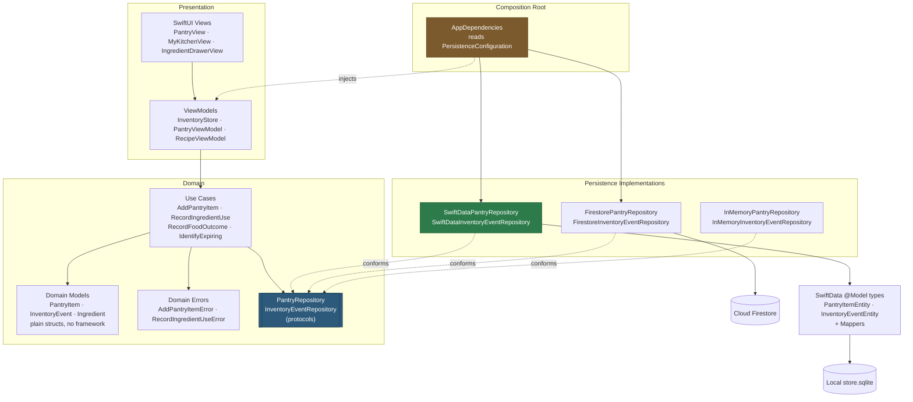

# Recommended Adapter Architecture

**Status:** **[Proposal]** throughout, except where marked **[Verified]**.
No production code has been modified.

---

## 1. The shape



The one rule the diagram encodes: **arrows into the protocol box, never past
it.** No view, view model or use case names a storage type.

---

## 2. What already exists vs what must be introduced

### 2.1 Reusable as-is — **[Verified]**

| Asset | Location | Why it needs no change |
|---|---|---|
| `PantryRepository` | `Domain/Protocols/PantryRepository.swift:12` | Already domain-shaped; SwiftData conforms to it unchanged |
| `InventoryEventRepository` | `Domain/Protocols/InventoryEventRepository.swift:15` | Append-only by design; maps cleanly onto SwiftData inserts |
| All domain models | `Domain/Models/**` | Plain structs. **Not one line changes.** |
| All domain errors | `Domain/Errors/**` | The SwiftData adapter throws the *same* errors |
| All use cases | `UseCases/**` | Depend only on protocols |
| All view models | `ViewModels/**` | Receive repositories by injection |
| All views | `Views/**` | Never name a storage type |
| Firestore adapters | `Data/Firestore*.swift` | Kept whole and still selectable |
| In-memory adapters | `Data/InMemory*.swift` | Remain the unit-test doubles |

**The reuse ratio is the headline of this design: ~30,800 lines of app code are
untouched.**

### 2.2 To be introduced — **[Proposal]**

| New file | Purpose |
|---|---|
| `Data/SwiftData/PantryItemEntity.swift` | `@Model` storage type for a pantry item |
| `Data/SwiftData/InventoryEventEntity.swift` | `@Model` storage type for an event |
| `Data/SwiftData/IngredientRecognitionEntity.swift` | `@Model` for a recognition record (new capability) |
| `Data/SwiftData/SwiftDataMappers.swift` | Pure entity ↔ domain conversion, no container needed |
| `Data/SwiftData/SwiftDataPantryRepository.swift` | `PantryRepository` conformance |
| `Data/SwiftData/SwiftDataInventoryEventRepository.swift` | `InventoryEventRepository` conformance |
| `Data/SwiftData/PersistenceContainer.swift` | Owns the single `ModelContainer` |
| `Data/PersistenceConfiguration.swift` | The one place the backend is chosen |
| `AppDependencies.swift` | Explicit composition root |

### 2.3 To be modified — **[Proposal]**, 3 files only

| File | Change | Risk |
|---|---|---|
| `ContentView.swift:40-133` | Take dependencies from `AppDependencies` instead of constructing Firestore repos at lines 41 and 82 | Low — mechanical |
| `Views/Support/PantryRepositoryEnvironment.swift:20-22` | Default must stop hardcoding `FirestorePantryRepository()` | **Must not be missed** (audit §2.3) |
| `FridgeFitApp.swift` | Build `AppDependencies` once; keep `FirebaseApp.configure()` | Low |

---

## 3. Persistence configuration — one switch, one place

**[Proposal]**

```swift
/// The one place that decides where business data is stored.
///
/// Deliberately not a per-screen or per-repository choice: a build in which
/// the pantry is local but its event log is in Firestore would record
/// history for food that the other store has never heard of.
enum PersistenceBackend: String {
    case swiftData
    case firebase
}

enum PersistenceConfiguration {
    /// Resolution order, highest first:
    ///  1. launch argument `-persistence swiftData|firebase`  (demo + UI tests)
    ///  2. compile-time default below
    static var backend: PersistenceBackend { /* … */ }

    private static let compiledDefault: PersistenceBackend = .swiftData
}
```

This mirrors a pattern **[Verified]** to be already established in the codebase:
`OnlineRecipeFeature` (`Data/OnlineRecipeFeature.swift:40`) is "the one place
that decides how much of the online-recipe feature is switched on, and the only
file that has to change to switch more of it on". Using the same idiom keeps one
mental model.

A launch argument is the right override because it makes the **live demo a
one-click scheme change** rather than a code edit, and lets both backends be
covered in CI.

> **Rule, stated explicitly:** no View and no ViewModel may read
> `PersistenceConfiguration`. Only `AppDependencies` does. **[Verified]** that
> this rule is currently kept for the Firebase choice — the only two places a
> backend is named are `ContentView.init()` and the environment key default.

---

## 4. The protocol addition that earns the "domain predicates" mark

**[Verified] problem.** Three use cases find one item by fetching the entire
collection and scanning it client-side:

```swift
// UseCases/Inventory/RecordIngredientUseUseCase.swift:49
guard let existing = try await pantryRepository.fetchAll().first(where: { $0.id == itemID })

// UseCases/Inventory/RecordFoodOutcomeUseCase.swift:76 and :99 — same shape
// UseCases/AddPantryItemUseCase.swift:65 — scans for a name match
```

The protocol offers no narrower read, so there is nowhere for a real query to
live. **[Proposal]** — add two methods, no more:

```swift
protocol PantryRepository: AnyObject {
    func fetchAll() async throws -> [PantryItem]
    func add(_ item: PantryItem) async throws
    func update(_ item: PantryItem) async throws
    func remove(id: UUID) async throws

    // NEW — both have an existing caller that is currently doing it the long way
    func fetch(id: UUID) async throws -> PantryItem?
    func fetchExpiring(before date: Date) async throws -> [PantryItem]
}
```

These are not speculative API. `fetch(id:)` replaces the three scans above;
`fetchExpiring(before:)` is the storage-side form of a policy that
**[Verified]** already exists as pure code in
`IdentifyExpiringInventoryUseCase` (`UseCases/Inventory/IdentifyExpiringInventoryUseCase.swift:19`).

In SwiftData they become genuine, type-checked predicates:

```swift
func fetch(id: UUID) async throws -> PantryItem? {
    var descriptor = FetchDescriptor<PantryItemEntity>(
        predicate: #Predicate { $0.id == id }
    )
    descriptor.fetchLimit = 1
    return try context.fetch(descriptor).first.map(PantryItemMapper.toDomain)
}

func fetchExpiring(before date: Date) async throws -> [PantryItem] {
    let descriptor = FetchDescriptor<PantryItemEntity>(
        predicate: #Predicate { entity in
            entity.expiryDate != nil && entity.expiryDate! < date
        },
        sortBy: [SortDescriptor(\.expiryDate, order: .forward)]
    )
    return try context.fetch(descriptor).map(PantryItemMapper.toDomain)
}
```

**Cost of the addition:** every existing conformance needs the two methods —
`FirestorePantryRepository`, `InMemoryPantryRepository`, and the test doubles
`FailingPantryRepository` (**[Verified]** to exist in the test target). Each is
a handful of lines. The Firestore version of `fetch(id:)` is a genuine
improvement: a single `getDocument()` instead of reading the whole collection.

> **Deliberately not added:** a generic `fetch(predicate:)`. It would push
> storage concepts into the domain and is the "generic repository framework" the
> brief rules out.

---

## 5. ModelContainer lifecycle and isolation

**[Proposal]**, built on the **[Verified]** isolation facts in
`COREDATA_VS_SWIFTDATA_DECISION.md` §4.1.

```swift
@MainActor
final class PersistenceContainer {
    let modelContainer: ModelContainer

    /// `inMemory` backs tests: each test gets a container that shares nothing
    /// with the last and leaves nothing on disk.
    init(inMemory: Bool = false) throws {
        let schema = Schema([
            PantryItemEntity.self,
            InventoryEventEntity.self,
            IngredientRecognitionEntity.self,
        ])
        let configuration = ModelConfiguration(
            schema: schema,
            isStoredInMemoryOnly: inMemory
        )
        modelContainer = try ModelContainer(for: schema, configurations: [configuration])
    }

    var mainContext: ModelContext { modelContainer.mainContext }
}
```

Decisions, each with its reason:

- **Exactly one container for the process**, owned by `AppDependencies`. Two
  containers over one store file is a corruption and staleness risk.
- **`mainContext` only; no `@ModelActor`.** `PantryRepository` and
  `InventoryEventRepository` are MainActor-isolated under this project's
  `SWIFT_DEFAULT_ACTOR_ISOLATION = MainActor` (**[Verified]**), and their only
  callers — `InventoryStore` is `@MainActor`
  (`ViewModels/InventoryStore.swift:36`) — are already on the main actor. A
  background `@ModelActor` would add isolation hops and `Sendable` plumbing to
  move data to the actor it started on. Pantry-sized working sets (tens of
  rows) do not justify it.
- **No `.modelContainer()` view modifier, no `@Query` in views.** `@Query` would
  bind a SwiftUI view directly to SwiftData — exactly the View→storage coupling
  this architecture exists to prevent, and it would work in SwiftData mode and
  silently show nothing in Firebase mode. Views keep reading `@Published` state
  from view models.
- **Explicit `try context.save()`** after each mutation, so a write either
  completes or throws where the use case can translate it.

### 5.1 Error translation

The SwiftData adapter must throw the **same domain errors** as the Firestore
one, or identical use-case code would behave differently per backend — and the
**[Verified]** existing tests assert on those errors.

| Condition | Firestore today **[Verified]** | SwiftData **[Proposal]** |
|---|---|---|
| Update a missing item | `UpdatePantryItemError.itemNotFound` (`FirestorePantryRepository.swift:54`) | same, when the `#Predicate` fetch is empty |
| Remove a missing item | `RemovePantryItemError.pantryItemNotFound` (`:61`) | same |
| No signed-in user | `PantryRepositoryError.notAuthenticated` (`:34`) | **not thrown** — a local store has no auth scope. See §7 |
| Underlying store failure | Firestore `NSError` propagates | wrap in `PantryRepositoryError.storageUnavailable` (new case) |

Adding one case to an existing `enum` is a contained change; **[Verified]** the
enum currently has a single case and a `switch` in one place
(`Domain/Errors/PantryRepositoryError.swift:9-19`).

---

## 6. Composition root

**[Proposal]**

```swift
@MainActor
final class AppDependencies {
    let pantryRepository: any PantryRepository
    let eventRepository: any InventoryEventRepository
    let backend: PersistenceBackend

    init(backend: PersistenceBackend = PersistenceConfiguration.backend) throws {
        self.backend = backend
        switch backend {
        case .swiftData:
            let container = try PersistenceContainer()
            pantryRepository = SwiftDataPantryRepository(context: container.mainContext)
            eventRepository  = SwiftDataInventoryEventRepository(context: container.mainContext)
        case .firebase:
            pantryRepository = FirestorePantryRepository()
            eventRepository  = FirestoreInventoryEventRepository()
        }
    }
}
```

`ContentView.init()` then takes these in rather than constructing them. **Its
other 90 lines of wiring are unchanged** — the recipe catalogue, the scanner,
substitutions and Discover all keep working exactly as they do now, because they
receive `pantryRepository` as a parameter already (**[Verified]**,
`ContentView.swift:62-132`).

**Failure policy:** if the `ModelContainer` cannot be created, do **not**
silently fall back to Firebase — a user whose local data failed to open should
not be shown an empty cloud pantry and conclude their food is gone. Surface it.

---

## 7. Data ownership — which store owns what

The rule, stated once so no feature has to re-litigate it:

> **Business data the user creates follows the configured backend. Real-time
> infrastructure, identity, and regenerable data never do.**

| Data | Owner | Why |
|---|---|---|
| Pantry items | **Configured backend** | The thing being demonstrated |
| Inventory events | **Configured backend** | Must match the pantry — history about food in another store is incoherent |
| Recognition records | **SwiftData only** | New capability; no Firestore collection or rules exist for it |
| Saved recipes | **Firebase only** | `nonisolated` protocol needs `@ModelActor`; feature gated off (**[Verified]**) |
| Bundled recipes | Compiled-in | Not user data |
| Online results / substitutions | In-memory cache | Regenerable |
| Preferences, device identity | `UserDefaults` | Already correct |
| Device presence | **Firebase, always** | Needs `addSnapshotListener` (**[Verified]**, `FirestoreDeviceRegistry.swift:130`) |
| WebRTC signalling | **Firebase, always** | Needs listeners + `runTransaction` (**[Verified]**, 4 sites) |
| Auth identity | **Firebase, always** | Firebase Auth owns it |

### 7.1 The honest consequence for authentication

In SwiftData mode the local store is **device-scoped, not user-scoped**.
Firestore scopes by `users/{uid}` (**[Verified]**, `firestore.rules:33-35`);
a local SQLite file has no such boundary, so two accounts signing into the same
device would see one pantry.

Options, in increasing cost:

1. **Accept and document it.** Correct for an assessment demo. SwiftData mode is
   a single-user, single-device configuration — state it in the presentation.
2. Store `ownerUserID` on each entity and predicate every query by it. Cheap
   (one field, one clause), and worth doing *if* account-switching is demoed.
3. One store file per uid. Most faithful, most work. Not justified.

**Recommendation: option 1, with option 2 as a stretch.** Pretending a local
store is auth-scoped when it is not would be the kind of unsupported claim this
codebase's own comments are careful to avoid.

---

## 8. Keeping the Firebase adapter genuinely alive

The brief requires the Firebase path to remain functional, not decorative.
Three mechanisms, all cheap:

1. **CI runs the suite against both backends** — the repository contract tests
   (`IMPLEMENTATION_AND_TEST_PLAN.md` §4) are generic over the implementation,
   so Firebase's conformance is re-proved on every run.
2. **The launch argument** makes Firebase mode reachable without a rebuild, so
   it is exercised by hand during the demo.
3. **Nothing is deleted** — `firestore.rules`, the emulator suite in
   `firestore-tests/`, and the three mapping test suites all stay.

---

## 9. Unresolved questions

1. **Should `ownerUserID` ship in v1?** Depends on whether account-switching is
   demonstrated (§7.1).
2. **Should the compiled default be `.swiftData` or `.firebase`?** This audit
   proposes `.swiftData` so the graded build demonstrates the graded feature by
   default — but it changes which store a grader sees on first launch, so it is
   the author's call.
3. **Migration plan if the schema changes after submission** —
   `DATA_MODEL_AND_RELATIONSHIPS.md` §7 proposes `VersionedSchema` from day one;
   not yet decided whether to add it before or after the first working build.
