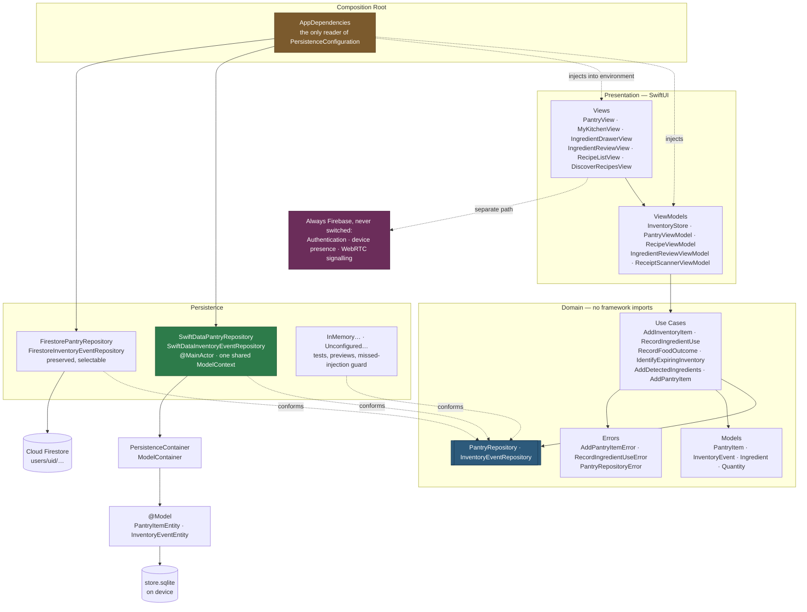
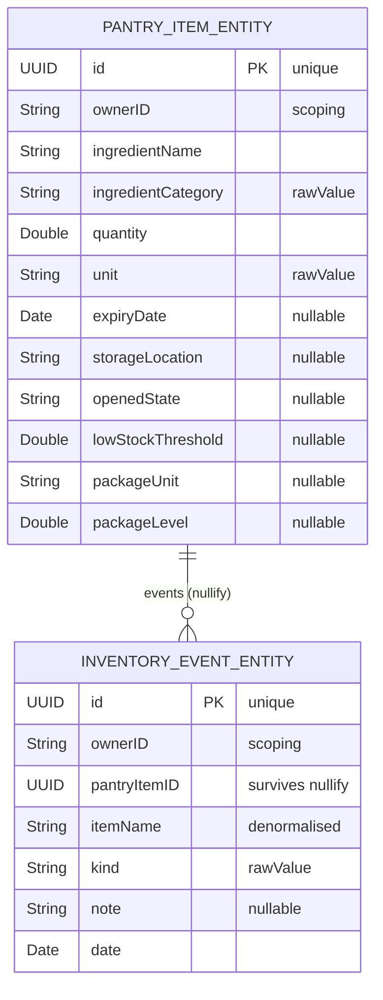
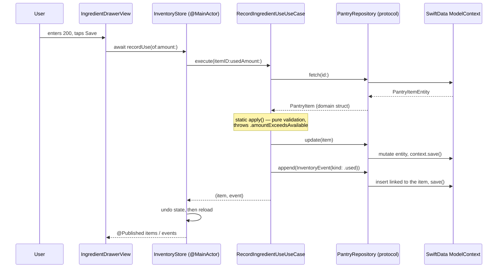

# Architecture and Data Model — As Implemented

Diagrams of what is in the code on `feat/swiftdata-persistence`, not of a
proposal. Every type named here exists.

---

## 1. Architecture



**The one sentence:** three implementations satisfy one protocol, and
everything above that protocol — every view, view model and use case — is
identical whichever is selected.

**Verified properties**

- No `View` or `ViewModel` imports SwiftData or names a repository type.
- `PersistenceConfiguration` is read in exactly one place, `AppDependencies`.
- `FirestorePantryRepository()` is constructed in exactly one place; all other
  occurrences are doc comments.
- `@Model` types exist only under `Data/SwiftData/`.

---

## 2. Relational schema



| | |
|---|---|
| Entities | 2 |
| Relationship | one-to-many, `PantryItemEntity.events` ↔ `InventoryEventEntity.item` |
| Cardinality | one item → zero or more events; one event → zero or one item |
| Delete rule | **`.nullify`** |
| Uniqueness | `@Attribute(.unique)` on both `id`s |

### 2.1 Why `.nullify` is correctness, not preference

`RecordFoodOutcomeUseCase` removes the pantry item and **then** writes the event
saying it was finished. Under `.cascade`, that delete would take the event with
it — the activity history would be permanently empty for exactly the two
actions users most want to look back at. So:

- the relationship nullifies, and the event survives;
- `pantryItemID` is stored as a plain `UUID` *beside* the relationship, because
  after a nullify it is the only thing identifying what the event was about, and
  it is what `InventoryStore.history(for:)` filters on;
- `itemName` is denormalised onto the event, because the item may be gone and
  "Finished" with no name is not history.

Asserted by `test_deletingAnItem_keepsItsHistory`, which checks both that the
history survives and that the relationship is `nil` rather than dangling.

### 2.2 Why only two entities

A third (`RecognitionSession` + its detections) was designed in the audit and
deliberately **not** built. The relational requirement is met by the pantry and
its history, every column above is load-bearing, and adding tables to raise a
count — while touching the detection pipeline to populate them — would have
bought risk rather than marks.

### 2.3 Owner scoping

Firestore scopes by the `users/{uid}` path with security rules behind it. A
local SQLite file has neither, so scoping is a stored `ownerID` column plus a
clause in **every** query, reads and writes alike — knowing a row's id is not
authorisation. A missing or empty owner throws
`PantryRepositoryError.notAuthenticated` rather than falling back to an
unscoped query.

Covered by `test_itemsAreScopedToTheirOwner`,
`test_anotherOwnerCannotUpdateOrRemoveYourItem`,
`test_withoutAnOwner_everyOperationThrowsNotAuthenticated` and
`test_ownerScopingSurvivesReopening`.

### 2.4 What is not stored

`inventoryQuantity`, `storage`, `opened`, `isLowStock` and `expiryState` are
computed on `PantryItem` and stay computed. Storing them would create a second
amount able to drift from `quantity`/`unit`, which is what `PantryItem` is
written to prevent.

Enums are stored as `rawValue` strings so a row is byte-comparable with the
Firestore document for the same item, and an unrecognised value decodes to
`nil` rather than discarding the row.

---

## 3. Domain predicates

Two were added to `PantryRepository`, each replacing a call site that was
reading the whole pantry and scanning it in Swift.

```swift
// One item. Was: fetchAll().first(where: { $0.id == itemID })
// in RecordIngredientUseUseCase and RecordFoodOutcomeUseCase (×2).
var descriptor = FetchDescriptor<PantryItemEntity>(
    predicate: #Predicate { $0.id == id && $0.ownerID == ownerID }
)
descriptor.fetchLimit = 1
```

```swift
// Expiring soon. Undated items are excluded by coalescing to the distant
// future - SwiftData cannot lower a force-unwrap into a store query, so
// `expiryDate != nil && expiryDate! <= date` compiles and then fails at
// fetch time.
let unbounded = Date.distantFuture
FetchDescriptor<PantryItemEntity>(
    predicate: #Predicate { item in
        item.ownerID == ownerID && (item.expiryDate ?? unbounded) <= date
    },
    sortBy: [
        SortDescriptor(\.expiryDate, order: .forward),
        SortDescriptor(\.ingredientName, order: .forward),
    ]
)
```

The second is a compound predicate over an optional date plus a two-key sort,
and it matches the ordering rule `IdentifyExpiringInventoryUseCase` already
applied in memory ("soonest first, then alphabetical").

The activity log adds a third: filter by owner, sort by date descending, with
`fetchLimit` applied **by the fetch** — the log only grows, so reading all of it
to show the newest 200 would get slower every time the user cooks.

---

## 4. Data flow: "user records using 200 g of chicken"



**The line to say over it:** the use case names no storage type. Swap SwiftData
for Firestore and this diagram changes in exactly one box.

---

## 5. Backend responsibilities

| Responsibility | SwiftData | Firebase |
|---|---|---|
| Pantry items, activity log | ✅ default | ✅ selectable |
| Relational integrity, delete rules | ✅ | ❌ not enforced |
| Compiler-checked queries | ✅ `#Predicate` | ❌ string field names |
| Works with no network or account | ✅ | ⚠️ SDK cache only |
| Multi-device | ❌ device-local | ✅ |
| Per-user security rules | ❌ `ownerID` column only | ✅ `users/{uid}` |
| **WebRTC signalling** | ❌ **impossible** | ✅ |
| **Device presence** | ❌ **impossible** | ✅ |
| **Authentication** | ❌ | ✅ |

The last three are not a preference. Signalling is a rendezvous between two
devices that cannot see each other, and a presence heartbeat's only audience is
another phone — two devices share no local store, so a local database cannot
perform the function at all. Those paths were not touched.

> **Switching backend copies nothing.** Each mode has exactly one source of
> truth. An item added under SwiftData is not in Firestore, and vice versa.
